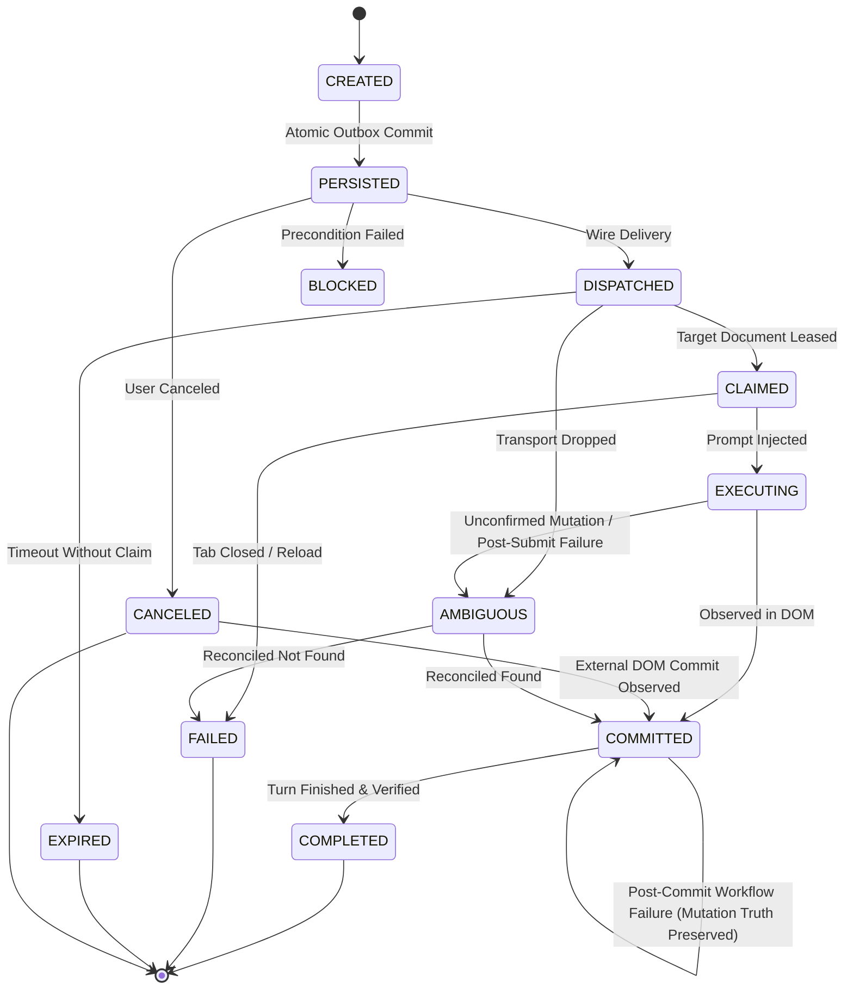

# Kosmosyn Transport Protocol V1 Architecture & Specification

## 1. Executive Summary & Purpose

Kosmosyn Transport Protocol V1 establishes a durable, typed, bidirectional command and event communication protocol between:
```
DESKTOP APP (Electron Main Authority)
        ↕
BROWSER TRANSPORT (Extension Background / Native Host)
        ↕
CHATGPT WEB SESSION (Content Script / DOM Session Engine)
```

The primary objective is transitioning from the legacy **action-driven** model (focus tab → query DOM → click button → infer state → guess retry) to a **state-driven** model (create durable command → atomic outbox commit → transport dispatch → explicit session claim → typed event stream → observable commit verification → safe reconciliation).

### Non-Goals
- **No Production Migration in This Phase**: Production traffic remains exclusively on the established production bridge (`src/main/bridge.ts`).
- **No Redesign of Frozen Workflows**: Phase 3 systems (Goal, Loop, Orchestrator, normal worker policy, ASK authorization, AUTO workers, worker/verifier model policies, Agents lifecycle, Orchestrator conductor state semantics) remain completely unchanged.
- **No UI Overhauls**: Renderer UI designs are out of scope.
- **No Heavy Distributed Frameworks**: No Kafka, Redis, Cadence, Temporal, or external database servers. This is a single-user desktop product; all persistence builds directly on atomic local NTFS/POSIX primitives.

---

## 2. Identity Architecture & Hierarchy

Every entity participating in the transport protocol has an explicit identity, lifetime scope, and canonical owner:

| Identifier | Format / Type | Scope | Canonical Owner | Description |
| :--- | :--- | :--- | :--- | :--- |
| **App Instance ID** | UUID string | `PROCESS_LOCAL` | Electron Main | Unique per app process run; invalidates old in-memory leases on restart. |
| **Desktop PID** | Integer | `PROCESS_LOCAL` | OS Kernel | Operating system process identifier. |
| **Protocol Version** | Literal `1` | `DURABLE` | Protocol Spec | Strict integer protocol version negotiated at handshake. |
| **Connection Epoch** | Opaque UUID | `EPHEMERAL` | Desktop Main | Fresh per accepted HELLO; equality with the current epoch is connection-incarnation authority. |
| **Connection Generation** | Integer | `EPHEMERAL` | Desktop Main | Legacy/diagnostic handshake correlation only. Once a connection epoch exists, numeric magnitude has no event-admission authority. |
| **Command ID** | `cmd_<uuid>` | `DURABLE` | Desktop Main | Unique opaque ID assigned to every command before persistence. |
| **Event ID** | `evt_<uuid>` | `EPHEMERAL` | Event Emitter | Unique opaque ID assigned to each emitted event; used for deduplication. |
| **Idempotency Key** | `idemp_<uuid>` / slug | `DURABLE` | Command Creator | Unique key representing semantic mutation intent; prevents duplicate execution. |
| **CoS Session ID** | Date slug / UUID | `DURABLE` | Session Store | Canonical Chat On Steroids local session entity. |
| **Conversation ID** | UUID `/c/<id>` | `CONVERSATION_LOCAL` | ChatGPT Web | ChatGPT web conversation identity. `null` only during initial composer bootstrap. |
| **Browser Instance ID** | UUID | `BROWSER_LOCAL` | Chrome Extension | Uniquely identifies a running Chrome browser session. |
| **Client Document ID** | `doc_<uuid>` | `EPHEMERAL` | Content Script | Unique per page/tab document instantiation; invalidated on navigation or reload. |
| **Emitter Epoch** | Opaque bounded string; content script uses Client Document ID | `EPHEMERAL` | Authorized emitter | Sequence-counter incarnation. Replacement is admitted only after command ownership/lease authority has accepted that emitter. |
| **Tab ID** | Integer | `BROWSER_LOCAL` | Chrome Tabs API | Chromium tab identifier. |
| **Turn ID** | `turn_<id>` / DOM attr | `SESSION_LOCAL` | ChatGPT DOM / Fiber | Identifies a single prompt-response turn in ChatGPT. |

### Rule on Identity Derivation
Command and event identities are **opaque UUIDs**. They are **never** derived from timestamps, prompt text content, or tab indices.

---

## 3. Command & Event Schemas

### 3.1 Command Envelope
```typescript
interface ProtocolCommand<TPayload> {
  protocolVersion: 1;
  commandId: string;
  commandType: 'SESSION_PROBE' | 'SEND_MESSAGE' | 'BIND_SESSION' | 'CANCEL_COMMAND';
  source: EndpointRole;
  target: EndpointRole;
  sessionId: string;
  conversationId: string | null;
  owner: string | null;
  generation: number; // legacy compatibility metadata; no connection-admission authority
  createdAt: number;
  expiresAt: number;
  idempotencyKey: string;
  payload: TPayload;
}
```

### 3.2 Command Payloads (Discriminated Union)
1. **`SESSION_PROBE`**:
   - `probeTabs`: boolean (default `true`)
   - `probeModels`: boolean (default `false`)
   - `targetConversationId`?: string | null
2. **`SEND_MESSAGE`**:
   - `text`: string (1 to 240,000 characters)
   - `targetConversationId`: string
   - `model`?: string | null
   - `reasoningEffort`?: string | null
   - `clientTurnId`?: string
   - `timeoutMs`: number (default 30,000ms)
3. **`BIND_SESSION`**:
   - `targetConversationId`: string
   - `sessionId`: string
   - `role`: `'prime' | 'worker'`
4. **`CANCEL_COMMAND`**:
   - `targetCommandId`: string
   - `reason`: string

### 3.3 Event Envelope
```typescript
interface ProtocolEvent<TPayload> {
  protocolVersion: 1;
  eventId: string;
  commandId: string;
  eventType: ProtocolEventType;
  source: EndpointRole;
  sessionId: string;
  conversationId: string | null;
  generation: number; // legacy/pre-handshake compatibility only
  connectionEpoch?: string;
  emitterEpoch?: string;
  sequence: number;
  occurredAt: number;
  payload: TPayload;
}
```

### 3.4 Key Event Types
- `COMMAND_PERSISTED`: Desktop has atomically committed command to disk.
- `COMMAND_DISPATCHED`: Transport accepted command for transmission.
- `COMMAND_CLAIMED`: Target document lease acquired (`clientDocumentId`, `tabId`).
- `MESSAGE_SUBMIT_STARTED`: Text injected, submit initiated.
- `MESSAGE_COMMITTED`: Matching user message observed in DOM with verification proof level.
- `TURN_STARTED`: ChatGPT started response generation (`Stop` button mounted).
- `TURN_COMPLETED`: Final response completed; terminal evidence collected.
- `COMMAND_COMPLETED`: Terminal protocol lifecycle success.
- `COMMAND_BLOCKED`: Precondition not met (wrong conversation, chat blocked, etc.).
- `COMMAND_FAILED`: Typed error occurred.

---

## 4. Command Lifecycle & State Machine



### State Semantics
- **`CREATED`**: Instantiated in memory. Proves only caller intent.
- **`PERSISTED`**: Written to disk outbox via atomic rename. Proves survivability across process crash.
- **`DISPATCHED`**: Transport layer accepted byte transmission. Proves network handover.
- **`CLAIMED`**: Specific browser document accepted exclusive lease. Proves target ownership.
- **`EXECUTING`**: Content script actively mutating DOM / injecting input. Post-submit failures during this state transition to `AMBIGUOUS`.
- **`COMMITTED`**: Irreversible side effect observed in ChatGPT conversation. Proves message is externalized. Overrides cancellation if commit is proven.
- **`COMPLETED`**: All post-conditions and terminal verification satisfied.
- **`AMBIGUOUS`**: Mutation dispatched, but success or failure cannot be definitively verified. **Auto-replay strictly forbidden.** Requires state reconciliation.

### 4.1 Command-Class-Specific Lifecycle Semantics
Protocol V1 defines strict, command-class-specific success pathways. Generic direct transitions from `DISPATCHED` to `COMPLETED` remain disallowed to protect mutating operations:

1. **Mutating Commands (`SEND_MESSAGE`)**:
   ```
   PERSISTED → DISPATCHED → CLAIMED → EXECUTING → COMMITTED → COMPLETED
   ```
   Requires verifiable, externalized physical mutation proof (`MESSAGE_COMMITTED` with `STRONG_COMMIT`, non-empty `nativeMessageId`, and conversation coherence) before entering `COMMITTED`. Direct completion from `DISPATCHED` or `EXECUTING` without commit proof is strictly forbidden (`INVALID_LIFECYCLE_FACT`).

2. **Read-Only Commands (`SESSION_PROBE`)**:
   ```
   PERSISTED → DISPATCHED → COMPLETED
   ```
   Passive state and tab inspection commands do not alter external application state and must not manufacture synthetic claims or commit facts (`COMMAND_CLAIMED`, `MESSAGE_COMMITTED`, `COMMITTED`, `STRONG_COMMIT`, `nativeMessageId`, `commitConversationId`).
   - **`COMPLETED != COMMITTED`**: For read-only commands, reaching `COMPLETED` signifies that probe observation succeeded. The command record transitions directly `DISPATCHED → COMPLETED` upon receipt of a validated `COMMAND_COMPLETED` carrying strictly `{ observedTabCount: number }` (bounded between 0 and 10,000). Commit evidence fields (`committedAt`, `commitProofLevel`, `nativeMessageId`, `commitConversationId`) remain permanently `null`.
   - **Mutation Truth Retention**: `ProtocolStore.recentCommittedIds` retains proven external mutation commits only. Completed `SESSION_PROBE` records are never indexed in `recentCommittedIds`.
   - **Terminal Cancellation**: Late cancellation of a `COMPLETED` `SESSION_PROBE` returns `ALREADY_COMPLETED` as a pure terminal no-op: no state change, no error record, no disk write, and no event/state notification. In contrast, late cancellation of commands that crossed mutation commit truth returns `COMMIT_ALREADY_OCCURRED`.

---

## 5. Commit Semantics & Ambiguity Handling

### 5.1 Commit Proof Levels for Mutations (`SEND_MESSAGE`)
1. **`STRONG_COMMIT`**:
   - Requires exactly one attributable new browser-native user-message identity that was absent from the pre-submit observed set.
   - The identity must belong to the command's target `/c/<conversationId>`; zero candidates, multiple plausible candidates, or a wrong conversation are `AMBIGUOUS`.
   - The durable command stores the native message identity and target conversation when commitment is accepted. The same native identity cannot commit two unrelated `SEND_MESSAGE` commands in one conversation.
   - Visible text is supporting evidence only. Identical visible messages remain distinct when their native IDs differ.
   - `MESSAGE_COMMITTED` is syntactically broad; `BrowserTransportService` is the semantic validation authority. A claimed `STRONG_COMMIT` becomes `COMMITTED` only for `SEND_MESSAGE` with a non-empty native ID, exactly one candidate, coherent conversation authorities, and no reuse by another command.
   - `candidateCount` is supporting browser/content-script evidence, not an independent authority; the native identity and correlation contract remain primary. The protocol POC adapter evidence is simulated until production transport migration.
   - A null command-envelope `conversationId` is allowed for `SEND_MESSAGE`; if non-null it must equal `payload.targetConversationId`. Event and commit-payload conversation IDs must also equal that target.
   - `matchedText` is optional transient supporting evidence. It is neither persisted in the durable command record nor logged by the service; durable commit truth stores identity/conversation, not prompt text.
   - Live qualification on 2026-10-03 observed three browser-visible user turn UUIDs. The two byte-identical `KOSMOSYN_NATIVE_ID_REPEAT` messages had different UUIDs. All three UUIDs survived a normal frontend rerender and full page reload unchanged. The current production `messageIdOf()` resolves the same UUID primitive through its browser-visible search/fiber fallback when `data-message-id` is absent.
   - No cookies, authorization headers, private backend endpoints, or authenticated network APIs are required for this identity proof.
2. **`WEAK_COMMIT`**:
   - Preliminary UI evidence: composer text cleared, send button clicked, or `Stop` button appeared, but without verified new user message ID in DOM.
   - **Safety Invariant (`UI_ACTION != COMMIT`)**: `WEAK_COMMIT` indicates progress only. It does **not** transition the command to `COMMITTED`.
3. **`AMBIGUOUS`**:
   - Send button was clicked or input dispatched, but before strong commit was verified:
     - The browser tab navigated, reloaded, or closed.
     - The desktop app or extension crashed.
     - The network connection dropped or timed out.
     - Composer remounted (`COMPOSER_STALE`) after submit was initiated.

### 5.2 Ambiguity Policy (Safety Invariant)
> **Under no circumstances does the protocol automatically replay a mutating command in `AMBIGUOUS` state.**
> A timeout is **never** a license to resend without proof. Re-querying session state and DOM history must occur before any retry decision.

### 5.3 Identity Roles
- `commandId`: durable protocol operation identity.
- `clientTurnId`: optional caller-side correlation identity; not commit proof.
- `nativeMessageId`: browser-native rendered user-message identity and the primary `SEND_MESSAGE` commit identity.
- No separate `submitAttemptId` is introduced because this milestone produced no evidence that it is required.

### 5.4 PROTOCOL_FINGERPRINT_V1
`PROTOCOL_FINGERPRINT_V1` covers this document plus every file under `src/shared/protocol/**`, `src/main/browser-transport/**`, and `test/protocol/**`. Normalize each relative path to forward slashes, calculate the raw-file SHA-256, sort lines as `<normalized-path>\\t<raw-file-sha256>`, terminate every manifest line with LF including the final line, UTF-8 encode that manifest, then SHA-256 the manifest bytes. This is the canonical candidate identity method; test counts are not architecture state.

---

## 6. Delivery, Idempotency & Deduplication

### 6.1 Transport Delivery: At-Least-Once
Network packets, IPC messages, and WebSocket frames can be delayed, dropped, or duplicated. The transport provides **at-least-once delivery**.

### 6.2 Processing Semantics: Idempotent
- **Commands**: Before creating or dispatching a command, the service queries the durable outbox for `idempotencyKey`.
  - If found with an **identical payload and parameters**: the existing record is returned without re-executing mutations.
  - If found with a **conflicting payload or parameters**: rejected immediately with `IDEMPOTENCY_CONFLICT`.
- **Event delivery identity**: `eventId` is ephemeral and identifies one delivery envelope, not an immutable external fact. Incoming events pass through a bounded `EventDeduplicator` (default 1,000 applied event IDs). Same-process redelivery is suppressed after successful processing.
- **Durable fact identity**: restart safety does not persist event UUIDs. It reuses the retained `DurableCommandRecord`. A strong `MESSAGE_COMMITTED` fact is `commandId + targetConversationId + nativeMessageId + MESSAGE_COMMITTED`. The same strong fact with a new `eventId` is a no-op reported as `FACT_ALREADY_APPLIED`. `COMMAND_COMPLETED` is lifecycle evidence, not an epoch-independent external fact.
- **Conflict policy**: once a command has a proven native message identity, a later strong commit claiming a different native identity is not a duplicate and is rejected as `CONFLICTING_DURABLE_FACT`; proven commit truth is never overwritten.
- **Write-failure policy**: delivery IDs are marked applied only after authoritative processing succeeds. Immutable commit/completion facts cross a synchronous durable commit barrier before their delivery ID is marked applied. Non-terminal progress transitions may be accepted into authoritative in-memory state and queue `writeDurableSoon()` before physical disk I/O completes; background retry then converges the durable projection. If a synchronous durable fact write fails, command state and store bookkeeping are rolled back, a newer safe snapshot supersedes the failed generation, and the event remains retryable.
- **Concurrency**: event handling is serialized at the service ingestion boundary so concurrent copies of one envelope, and concurrent different envelopes describing the same durable fact, converge to one applied fact without defining protocol sequence ordering.
- **Notifications**: transport duplicates and durable factual duplicates do not emit a second event/state notification. Ephemeral/progress observations that do not change the durable command record may still notify current-process listeners.
- **Retention**: no durable event journal is introduced. Durable fact authority lives only with the retained command record and disappears when that command is legitimately pruned; delivery dedupe remains bounded in memory.
- **Generations**: Distinct generation scopes protect against lagging events. Ephemeral transport reconnects must not discard legitimate commit events from an active conversation document.

### 6.3 Event Classifications

| Event type | Mutates durable command state | Durable fact identity required | Restart replay policy / stable identity |
| :--- | :---: | :---: | :--- |
| `COMMAND_PERSISTED` | No | No | Observation of desktop-owned state; no durable event dedupe. |
| `COMMAND_DISPATCHED` | No | No | Progress observation; durable command state is authoritative. |
| `COMMAND_CLAIMED` | Yes | No | Progress transition; reconcile against current durable lifecycle, not historical event UUIDs. |
| `SESSION_BOUND` | No | No | Ephemeral current-session observation; a post-restart bind may be new. |
| `SESSION_LOST` | No | No | Ephemeral current-session observation. |
| `TAB_ACQUIRED` | No | No | Ephemeral browser observation; never suppress a legitimate new acquisition from historical state. |
| `TAB_LOST` | No | No | Ephemeral browser observation. |
| `COMPOSER_ACQUIRED` | No | No | Ephemeral document/composer observation. |
| `COMPOSER_INVALIDATED` | No | No | Ephemeral document/composer observation. |
| `MESSAGE_SUBMIT_STARTED` | Yes | No | Progress transition to `EXECUTING`; durable lifecycle governs replay. |
| `MESSAGE_COMMITTED` | Yes | Yes | Durable external fact: command + target conversation + native message ID + semantic type. |
| `TURN_STARTED` | No | No | Progress observation; no historical suppression. |
| `TURN_COMPLETED` | No | No | Turn observation in V1; command completion remains separate durable authority. |
| `TURN_FAILED` | No | No | Turn observation in V1; does not itself define terminal command identity. |
| `COMMAND_BLOCKED` | Yes | Contextual | Retryable lifecycle state; identical delivery IDs dedupe in-process, later block facts may be meaningful. |
| `COMMAND_FAILED` | Yes | Contextual | Terminal command result; durable state prevents lifecycle regression, while failure payload semantics are not collapsed into a global event-type key. |
| `COMMAND_COMPLETED` | Yes | No | Current-emitter lifecycle evidence. It must pass connection/emitter freshness and lifecycle validation; a completed command still makes later completion a factual no-op. |

The protocol therefore targets **at-least-once delivery + idempotent factual processing + durable state convergence**. It does not claim exactly-once delivery.

### 6.4 Event Ordering Model

- **Sequence owner**: within one emitter epoch, the event emitter identified by `source`. Desktop does not synthesize or renumber peer sequences. V1 currently defines this receiver contract only; no production/PoC peer sequence allocator is implemented in the repository.
- **Sequence scope**: `(commandId, source, emitterEpoch)`. It is not global and it is not shared across `content-script` and `extension-background`; those roles are independent emitters and do not coordinate one counter.
- **Start / increment**: a producer starts at `1` for its source scope and increments by one for each newly emitted semantic event. `0` is invalid. At-least-once transport may duplicate an envelope without allocating a new sequence.
- **Reset**: no reset is valid while the same retained `(commandId, source, emitterEpoch)` remains authoritative. An authorized replacement emitter may begin at sequence 1; stale prior-emitter progress is rejected before ordering comparison.
- **Receiver high-water rule**: the durable command record stores the highest accepted sequence, semantic event type, and canonical semantic-payload identity independently for each source. A higher sequence is accepted even when it contains a gap because missing transport delivery cannot be inferred to be domain failure.
- **Same sequence**: same source + same sequence + same semantic type + same canonical semantic payload is an ordering replay. A different event type or different semantic payload is `SEQUENCE_COLLISION`. Durable facts are not discarded solely for such a collision; they continue to domain validation because sequence is not factual authority.
- **Lower sequence**: stale non-factual progress is rejected as `LOWER_SEQUENCE`. A valid strong `MESSAGE_COMMITTED` fact bypasses sequence suppression and is decided by immutable native-message identity instead. `COMMAND_COMPLETED` does not bypass epoch freshness.
- **Cross-command rule**: each command has independent source high-water marks. Interleaving such as `A1, B1, B2, A2` cannot interfere.
- **Cross-source rule**: there is no numeric comparison between `content-script` and `extension-background`. Handoffs are resolved by the command lifecycle and durable facts, not by pretending independent counters form one total order.
- **Durable-fact override**: sequence never overrides native-message identity conflicts, invalid lifecycle transitions, an already proven `COMMITTED` state, or durable factual identity. In particular, late `MESSAGE_SUBMIT_STARTED` cannot regress `COMMITTED`, and `COMMAND_COMPLETED` cannot manufacture commit truth.
- **Restart / write failure**: ordering high-water marks are part of the durable command record. They survive desktop restart. Advancing ordering authority crosses an immediate durable write barrier before the delivery ID is marked processed; if that write fails, both command mutation and ordering metadata roll back and the event remains retryable.
- **Rejected-event policy**: an event returned as rejected does not consume or advance the ordering slot. Events that are accepted as an ambiguity/failure observation may advance it even when their claimed domain evidence is insufficient; corrected durable facts still bypass ordering suppression and are re-evaluated by domain identity/lifecycle authority.
- **Generation boundary**: `source` is a bounded role enum and the durable record retains only one active emitter epoch/high-water slot per source, so state remains bounded. Ordering is proven inside one emitter epoch; replacement establishes a new epoch rather than comparing counters across incarnations.

---

## 7. Durability Architecture & Guarantee Boundaries

### Verdict: `EXISTING_DURABLE_REUSE = YES`
`src/main/durable.ts` provides:
- Write to temp file + atomic rename over target (NTFS & POSIX atomic guarantees).
- Per-named-state serialization queue (prevents concurrent write corruption).
- Immediate synchronous flush (`writeDurableNow`) for commit barriers.
- Debounced background flush (`writeDurableSoon`) for progress tracking.
- Corrupted file resilience (returns `null` on parse errors).

### Honest Durability Guarantee Boundary
- **Process Crash Consistency: YES**. Electron crashes, exceptions, or process terminations cannot leave half-written or corrupted files; atomic rename ensures the file points to either the old or new snapshot.
- **Hardware Power-Loss Durability: NO**. Neither `filehandle.sync()` nor `FlushFileBuffers` is called on the file or directory. Sudden power failure may lose page cache contents. Architecture claims must honestly state process-crash consistency rather than fsync-grade power-loss guarantees.

The protocol store is persisted under:
`userData/state/kosmosyn-transport-outbox.json`

---

## 8. Handshake & Capability Negotiation

When a transport channel connects:
1. **`HELLO`** (Extension → Desktop):
   - `protocolVersion`: `1`
   - `extensionVersion`: string
   - `capabilities`: array of `ProtocolCapability`
   - `connectionGeneration`: number (peer compatibility/diagnostic input; it cannot choose or supersede the desktop epoch)
2. **`WELCOME`** (Desktop → Extension):
   - `acceptedProtocolVersion`: `1`
   - `desktopInstanceId`: UUID
   - `negotiatedCapabilities`: supported subset
   - `reconcileRequested`: `true`
   - `connectionGeneration`: desktop compatibility correlation value
   - `connectionEpoch`: fresh opaque desktop-minted epoch
3. **`READY`** (Extension → Desktop):
   - must echo the current `connectionGeneration` and exact `connectionEpoch`; an epoch-less or superseded READY cannot activate the connection.
4. **`REJECT`** (Desktop → Extension):
   - Dispatched immediately if `protocolVersion !== 1`.
   - Reason: `'PROTOCOL_MISMATCH'`.

---

## 9. Transport Comparison: Loopback HTTP vs Chrome Native Messaging

| Criterion | Current Loopback HTTP Bridge | Chrome Native Messaging | Recommended Direction |
| :--- | :--- | :--- | :--- |
| **Channel Mechanism** | HTTP/1.1 REST over `127.0.0.1:8765-8769` | `stdio` pipe managed by Chrome | **Hybrid via Transport Abstraction** |
| **Setup & Registry** | Zero registry modification required | Requires Windows Registry key + Host Manifest JSON | HTTP for dev/current; Native Messaging optional |
| **Extension ID Dependency**| Agnostic; validates `chrome-extension://` origin | Requires hardcoded Extension ID in manifest | HTTP is easier for unpacked dev; NM for release |
| **Persistent Connection** | HTTP polling / SSE / wake trigger | Native pipe open; keeps MV3 worker alive | Native Messaging eliminates MV3 30s sleep |
| **Firewall / Port Conflicts** | Sensitive to port collisions & local security rules | Immune to firewall / port collision issues | Native Messaging superior for strict IT environments |
| **Message Limits** | Bounded by HTTP body limit (default 2-4MB) | 1MB message size limit in Chrome | Protocol chunks large inputs |
| **Performance / Latency** | ~2-5ms loopback roundtrip | < 1ms pipe roundtrip | Both negligible compared to ChatGPT DOM |
| **Migration Risk** | Zero; already working in production | High; requires host installer & registry wiring | Keep HTTP production bridge; use adapter for NM |

### Rust Native Host Evaluation
- **`RUST_NATIVE_HOST_VALUE = MEDIUM`**
- **`RECOMMENDED_NOW = NO`**
- **Rationale**: While a Rust binary (`cos-native-host.exe`) offers a tiny footprint (~2MB) and safe I/O framing, introducing a Rust toolchain into the build pipeline now would add packaging complexity without improving protocol correctness. Node/Electron already handles native IPC cleanly. The protocol state machine is strictly transport-independent via `TransportAdapter`.

---

## 10. Proof of Concept & Fault Injection Verification

An isolated, transport-independent POC was implemented in `src/main/browser-transport/` and validated by the focused protocol suite in `test/protocol/`:

1. **`test/protocol/protocol-schemas.test.ts`**:
   - Validates commands, events, handshake, capabilities, and error codes.
2. **`test/protocol/protocol-lifecycle.test.ts`**:
   - Validates state transitions, idempotency deduplication, legacy pre-handshake generation rejection, and post-commit cancellation refusal.
3. **`test/protocol/protocol-durability.test.ts`**:
   - Validates disk outbox persistence via `durable.ts` and restart recovery.
4. **`test/protocol/protocol-fault-injection.test.ts`**:
   - Covers deterministic transport and lifecycle failure scenarios including:
     1. Desktop dies after persist but before dispatch → safe outbox resume.
     2. Same command delivered twice → idempotency key dedupes.
     3. Extension dies before ACK → mutating command becomes AMBIGUOUS.
     4. Browser reloads mid-command → transitions to AMBIGUOUS.
     5. Composer remounts before any possible submit: COMPOSER_STALE; safe retry may be allowed. After submit may have occurred: AMBIGUOUS; no automatic replay.
     6. Commit verified but completion event lost → stays COMMITTED, no double-send.
     7. Duplicate event delivery → EventDeduplicator absorbs safely.
     8. Pre-handshake stale numeric generation → rejected with STALE_GENERATION; after epoch negotiation, opaque epoch equality is authoritative.
     9. Wrong conversation targeted → marked BLOCKED / FAILED.
     10. Tab closed during operation → marked FAILED (TAB_CLOSED).
     11. Incompatible protocol version → handshake rejects with PROTOCOL_MISMATCH.
     12. Command timeout/expiry → lease expired, claim refused.
     13. Cancel before commit → successfully transitions to CANCELED.
     14. Cancel after commit → refused with COMMIT_ALREADY_OCCURRED.
     15. Transport disconnect/reconnect → outbox cleanly redelivers without data loss.
5. **`test/protocol/protocol-ordering.test.ts`**:
   - Proves per-command and per-source isolation, forward-gap acceptance, late-lower rejection, same-sequence type/payload collision handling, durable-fact override, completion-before-commit rejection, restart persistence, and ordering-write rollback.
## Generation separation

Protocol V1 treats lifetime identity and ordering as separate concerns:

- `connectionEpoch` is an opaque desktop-minted identity for exactly one negotiated transport incarnation. READY and non-durable event admission require equality with the active epoch; epochs are never compared numerically.
- Epoch fields remain optional in the wire schema only for legacy/pre-handshake compatibility and epoch-independent strong commit reconciliation. Once an epoch-aware connection is negotiated, non-durable/current-lifecycle traffic without `connectionEpoch` or `emitterEpoch` is rejected rather than downgraded to legacy authority.
- `emitterEpoch` identifies one sequence-counter owner incarnation. For content-script events it is the document identity established by `COMMAND_CLAIMED`. A claim can establish/replace emitter authority only when the same document already holds a valid command ownership lease; an event cannot bypass `claimCommand()`. A replacement document may restart its sequence at 1; progress from the superseded document is stale.
- `sequence` is ordered only inside one command/source/emitter epoch. It has no meaning across emitter epochs.
- strong external mutation facts are reconciled by durable domain identity (`commandId`, target `conversationId`, `nativeMessageId`) even when reported by a superseded emitter. Rediscovery of the same fact remains `FACT_ALREADY_APPLIED`.
- `COMMAND_COMPLETED` is not equivalent to strong external mutation proof. It must come from the current connection/emitter and pass lifecycle validation; stale completion cannot terminate replacement work.
- durable command intent is not bound to a transport epoch. The legacy numeric `generation` command field remains wire-compatible but is emitted as `0` and carries no connection-admission authority.
- The event `generation` field is retained for legacy/pre-handshake compatibility. Once `connectionEpoch` exists, its numeric value has no freshness or supersession authority.

The service retains only the active emitter epoch and its high-water ordering slot per command/source. It does not keep an unbounded connection or epoch journal.

## S4 passive SESSION_PROBE sidecar (candidate for independent HEAD review)

Baseline: `custom/main`, `0e5232fcdb14a94f7bbdc36d7979f3be2b3ac536`.
S4 remains an internal diagnostic; legacy production transport owns ordinary input.
No startup invocation, interval, public MCP tool, UI, content-script role, or S5 integration is added.

Explicit main-process invocation is `runS4Canary({ enabled: true })` exported from `bridge.ts`.
It requires the existing bridge to be running and sends the literal `protocol-canary` topic
on its existing authenticated `/wake` socket. That frame carries no body or identity.
The extension's dedicated pump does not invoke maintenance, browser-control, model discovery,
pairing repair, or legacy input delivery. It has one active flight, one coalesced wake bit,
and at most two passes per flight; it does not schedule retries or recurring work.

All sidecar routes are POST-only on the existing loopback HTTP listener:

| Route | Request body | Response |
| --- | --- | --- |
| `/protocol/hello` | `{ hello: HELLO, emitterEpoch }` | Existing V1 WELCOME or REJECT |
| `/protocol/ready` | `{ ready: READY, emitterEpoch }` | `{ ready: true }` on exact current authority |
| `/protocol/poll` | `{ connectionEpoch, connectionGeneration, emitterEpoch }` | `{ command: ProtocolCommand \| null }` |
| `/protocol/events` | Same authority fields plus `{ event: ProtocolEvent }` | Existing service admission result |

They retain constant-time paired bearer authentication, the Chrome extension Origin boundary
(including the existing headerless extension-fetch allowance), compatibility/build fencing,
authenticated rate limiting, and existing request body caps. They never use `/status`,
`/events`, or legacy command queues for Protocol traffic. Disabled/idle sidecar routes return 503.
Protocol HTTP failure does not update legacy presence or legacy connection state.

`CurrentBridgeAdapter` implements the existing `TransportAdapter` with one volatile command slot.
It rejects every command except a fixed, validated background SESSION_PROBE. Polls return a copy
of the same durable command identity; the slot is not a second durable store. Expired envelopes
are not handed out. Disconnect and command identity fencing prevent a late submission from
occupying a later invocation's slot. Handout begins only after durable dispatch publication.

The controller permits one active canary and returns BUSY immediately to concurrent callers.
Initialization and HELLO/WELCOME/READY have a bounded deadline (default 5 seconds); command
submission/completion has a separate bounded deadline (default 10 seconds; maximum 30 seconds
per phase). No command is created before exact current READY. Each deliberate invocation uses
new independent Protocol session, command, and idempotency identities. Retries retain the same
durable command identity. Disable, timeout, and failure retire volatile authority and release BUSY.
If submission/terminalization remains unresolved, one `cleanupCommandId` and one
`cleanupInFlight` operation retain custody beyond the visible deadline. Cleanup waits for the
non-cancellable submission to settle before reconciling that exact identity. No timed-out command
is automatically replayed. Existing in-flight restart expiry remains unchanged.

Every later explicit invocation checks retained cleanup before creating work. During a cleanup
flight it returns bounded `CLEANUP_PENDING` without adding another continuation or command.
After a failed flight it starts at most one reconciliation attempt and returns `CLEANUP_PENDING`;
another deliberate invocation can proceed once cleanup has succeeded. Cleanup has constant-size
state, no queue, timer, periodic retry, replacement probe, or command-ID reuse.

The service's narrow `expireReadOnlyCommand(commandId)` authorizes only SESSION_PROBE and
serializes with event acceptance. `PERSISTED` and `DISPATCHED` become `EXPIRED` only after
immediate durable persistence succeeds. Existing COMPLETED/FAILED/EXPIRED/CANCELED records
remain unchanged. A failed expiry restores the exact prior in-memory record and supersedes the
failed persistence generation with the restored snapshot; cleanup retains its single identity
and does not claim success. Reconciliation retries require another explicit S4 invocation.
The first durably accepted terminal transition wins: completion/failure already in flight may
finish before expiry; events queued behind durable expiry cannot change state or metadata.

At the visible deadline the controller clears dispatch publication and the volatile slot.
Cleanup and idle routes cannot hand the command out. The existing adapter and background
executor additionally reject envelopes at/after `expiresAt` before a new observation begins.

The only payload is `{ probeTabs: true, probeModels: false, targetConversationId: null }`,
with command `conversationId: null`. The background executor calls only
`chrome.tabs.query({ url: CHATGPT_TAB_URLS })` and counts the returned array. Zero tabs succeeds.
It rejects altered payloads/targets and counts above 10000. It sends no content-document message,
creates/activates/navigates/reloads/closes no tab, focuses no window, and writes no storage.
No claim, document lease, composer ownership, model discovery, or mutation proof is involved.

The worker mints a cryptographically strong opaque emitter epoch once per incarnation and keeps
one monotonic source sequence in memory. Missing strong crypto disables only S4. Connection
epochs come exclusively from WELCOME; equality fences READY, polling, and event admission.
The existing COMMAND_COMPLETED event carries exactly `{ observedTabCount: integer }` in 0..10000.
Query failure uses existing COMMAND_FAILED/UNKNOWN_ERROR with the fixed message
`S4 passive tab observation failed`, no raw error, stack, URL, or tab detail.

Successful controller output contains only `ok`, `commandId`, `state: COMPLETED`, `createdAt`,
`dispatchedAt`, `completedAt`, `connectionEpoch`, and transient `observedTabCount`.
Failure output contains only `ok`, bounded `failureCode`, and optional `commandId`/`state`.
Completed probes have no commit proof and never enter `recentCommittedIds`.

RED exposed an integration defect in the accepted service: completion ordering metadata stored
the literal serialized tab-count payload, despite its transient-evidence contract. A narrow
service repair uses a keyed, process-local digest for probe-completion payload equality. It
preserves sequence collision and failed-write rollback semantics without retaining tab count
or the digest key in the durable outbox. No wire schema, store, lifecycle transition, or mutation
command semantics changed.

Deterministic evidence lives in `test/protocol/protocol-s4-canary.test.ts`, `test/bridge.test.ts`,
and `test/browser-wake.test.ts`. The bridge integration executes the shipped background code
through real loopback HTTP and authenticated WebSocket traffic with a passive Chrome API fixture.
This proves source and transport behavior; it is not an installed/live Chrome acceptance claim.
Initial RED: eight failures across missing adapter/controller, background execution/wake, and
four authenticated routes returning 404. Additional RED covered persisted count evidence and
unbounded slow initialization. Existing extension and S3 tests are unchanged.

Pre-repair verification (2026-10-05; historical, superseded by the timeout repair below):
S4 59/59; Protocol 152/152 (the accepted 93 plus 59 S4);
browser-wake 5/5; extension 262/262; bridge 581/581. Typecheck, build, and diff-check passed.
`verify:ci` passed: 284 main test files, 6995 tests, then two serialized files with 26 tests;
the existing five opt-in skipped files/51 skipped tests are unchanged. Privacy passed with
724 commits/18 tags; notice/native-source checks passed. Blender passed without changes.
An initial full run exposed missing crypto in legacy VM hosts and one transient existing
input timing failure. Crypto failure now disables S4 only; affected untouched suites passed,
the exact input case passed on rerun, and the subsequent complete gate passed.
Real HTTP coexistence covers legacy status/events/command redeem/browser-control, ordinary
input claims while idle/handshaking/outstanding and after Protocol store/handshake failure,
concurrent correlation ingress, and unchanged Goal state. No browser/page mutation was observed
by the executor's forbidden-operation fixtures; no installed/live acceptance is claimed.

HEAD is unchanged; no staging, commit, push, packaging, or installation occurred.
Independent HEAD review subsequently reproduced unresolved durable probes after timeout;
the pre-repair candidate was not accepted. The timeout repair below retains that Git gate.
`PRODUCTION_TRANSPORT_MIGRATED=NO`; `MUTATION_AUTHORITY_ADDED=NO`; `S5_IMPLEMENTATION_STARTED=NO`.

### S4 timeout durable cleanup repair (2026-10-05)

Before implementation changes, two deterministic durable-service regressions failed: the
already-dispatched timeout left a DISPATCHED row, and blocked submission created a late
PERSISTED row; both expected EXPIRED. The controller had retired visible/volatile ownership
without retaining custody of the non-cancellable submission or reconciling durable state.
The former regression that accepted one unresolved command now requires zero after cleanup.

The focused suite now contains 79 cases. New coverage exercises delayed PERSISTED/DISPATCHED
submission, late COMPLETED/FAILED preservation, submission rejection, repeated timeouts,
poll fencing during blocked expiry, two bursts of 100 invocations sharing one cleanup flight,
real filesystem expiry failure and exact rollback, explicit cleanup retry, serialized terminal
races (including failed writes), probe-only expiry authority, and unchanged restart/no-replay
behavior. After every settled timeout cleanup, `getUnresolvedCommands().length === 0`;
terminal historical records remain. Normal success, zero/positive tab counts, one-slot bounds,
mandatory handshake, stale-authority rejection, mutation exclusion, and independent legacy
routes remain covered by the existing candidate suites.

Fresh final verification: S4 79/79; Protocol 172/172; browser-wake 5/5; extension 262/262;
bridge 581/581; typecheck, build, and diff-check passed. `npm run verify:ci` exited 0:
284 main files / 7015 tests passed, then 2 serialized files / 26 tests passed; the existing
5 opt-in skipped files / 51 skipped tests remain unchanged. Privacy passed (724 commits,
18 tags), notices passed (154 packages / 9 catalog entries), native-source checks passed
(730 archives/patches). The first full attempt exposed a 100ms setup deadline in a new
late-terminal test; it now verifies durable DISPATCHED before holding submission through
timeout. The historical Blender ownership case also timed out once, passed its exact
independent rerun, and passed the complete final gate; Blender was not modified.

Branch/HEAD remain `custom/main` / `0e5232fcdb14a94f7bbdc36d7979f3be2b3ac536`, staged 0,
with exactly the original 7 modified + 3 untracked candidate files. Repair edits are limited
to this document, `s4-canary.ts`, `service.ts`, and the S4 test file. No temporary repair files,
staging, commit, push, merge, packaging, or installation. Source repair is ready for independent
HEAD review; acceptance and the Git commit gate remain pending. No S5 work was started.

### S5 first-slice legacy claim decision shadow (2026-10-05)

The S5 implementation candidate adds a synchronous observation immediately after a successful
legacy `/input/claim`, under `CLF_KOSMOSYN_SHADOW_V0=1`. Null claims and Shadow OFF perform no
S5 evaluation. The bridge passes detached scalar facts from the exact returned claim, including
its frozen delivery text and a boolean for all returned root/companion media. Both the observer
and its bridge call contain exceptions, including failed diagnostic accounting; the legacy
HTTP 200 `{ input }` response, outbox, retry and recovery ownership remain unchanged.

The pure evaluator uses the current Protocol payload field schemas without creating a command.
Decision/helper semantics take precedence and yield NOT_EVALUABLE. Ordinary text, target,
media, model and reasoning checks yield WOULD_ADMIT or a bounded WOULD_REJECT reason.
Null-target New Chat and media deliveries are meaningful hypothetical rejections. Runtime
readiness is independently NOT_ARMED and never turns a policy admission into a rejection.

One `LEGACY_BROWSER_CLAIM_DECISION` fact retains only the legacy input ID, policy verdict/reason,
NOT_ARMED and claim time. Repeated claims deduplicate before evaluation. Final comparisons
derive from membership in already-admitted S3 `LEGACY_INPUT_NATIVE_CORRELATED` facts; ACK,
receipt, native ID and recorder history alone supply no positive proof. An accepted combined
root/companion correlation resolves one root sample. S3's accepted cancelled/decision receipt
semantics remain unchanged. Confirmed WOULD_ADMIT becomes AGREED_ADMIT; confirmed WOULD_REJECT
becomes LEGACY_ALLOWED_PROTOCOL_REJECTED; helper or deferred evidence becomes NOT_COMPARABLE.
Unresolved claims remain PROVISIONAL. Reject-side legacy outcomes/classifications are deferred.

S5 shares the existing retained-plus-pending 256-fact envelope. It has no separate result store,
Promise, per-send timer, retry queue or durable state. A fixed 300000ms horizon advances only
with existing bounded Shadow/S3/claim activity; reads alone do not age claims. Valid late S3
proof may still resolve an aged sample. Known conflicts, lost receipts, failed diagnostic
processing or capacity loss latch one conservative integrity fence for the current append-only
sample, suppressing all final comparisons until reset/restart. This intentionally sacrifices
diagnostic coverage instead of guessing affected identities or trusting retained stale proof.
Saturation remains a sampling limitation. Reset/restart drops S5 facts without replay.

`test/kosmosyn-shadow-s5.test.ts` initially demonstrated six missing-seam failures (exit 1),
then passed 52 cases. Coverage includes real legacy HTTP claim/ACK/events, exact frozen text,
real companion media, shared bounds, privacy, lost/conflicting proof and failure isolation.
This is source/test evidence, with independent HEAD implementation review still pending.
No Protocol schema, capability, handshake, lifecycle, store or production transport changes.
No staging, commit, push, merge, packaging, installation or S6 implementation is authorized.

Fresh candidate verification: S5 52/52; S0-S5 plus Protocol 12 files / 341 tests;
bridge 581/581; session-input 190/190; input-delivery-integration 278/278. All exited 0.
Typecheck, build and diff-check exited 0. The first `verify:ci` run exited 1 with only the
historical Blender disable-ownership 30000ms timeout; its exact independent rerun passed.
The complete unchanged gate then exited 0: 285 main files / 7067 tests, followed by two
serialized files / 26 tests. Existing five skipped files / 51 skipped tests are unchanged.
Privacy passed (725 commits / 18 tags), notices passed (154 packages / 9 catalog entries),
and native-source checks passed (730 archives/patches). Blender was not modified.
Branch/HEAD remain `custom/main` / `c3f26041d03635c0bb1901f70a97cd69ab6a5f41`, staged 0;
the candidate is limited to `shadow.ts`, `bridge.ts`, the new S5 test and this document.
Independent HEAD acceptance remains pending; no installed/live-browser acceptance is claimed.
